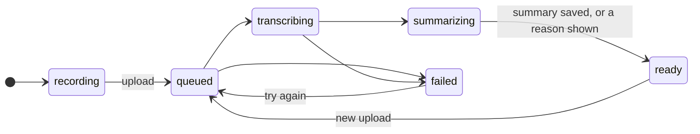
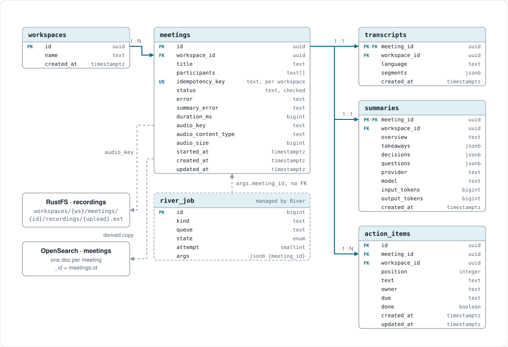
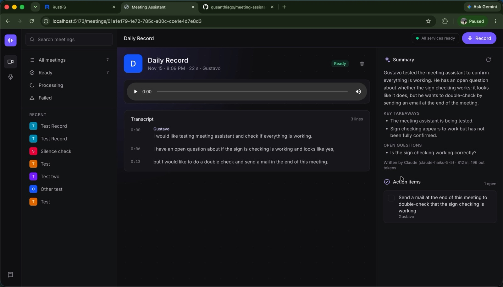

# Meeting Assistant

Record a meeting in the browser or upload an audio file, and get a transcript, a summary with action items, and search across everything that was said. A study project in Go and React that runs entirely on your machine with Docker.

- **Backend:** Go, one binary serving a REST API (OpenAPI contract) and running background jobs
- **Frontend:** React + TypeScript + Tailwind
- **Data:** Postgres (behind PgBouncer), River job queue, OpenSearch for search, S3-compatible object storage for audio
- **Transcription:** local Whisper (faster-whisper) in Docker, so your voice is transcribed on your machine with no API key
- **Summaries:** Claude Haiku 5.5 when an API key is set, a rule-based summarizer offline

## Quick start

You need Docker with Compose, with about 4 CPUs and 6 GB of RAM for Docker (on macOS with Colima: `colima start --cpu 4 --memory 6`; on Linux, OpenSearch also needs `sudo sysctl -w vm.max_map_count=262144`).

```bash
cp .env.example .env   # local defaults work as is
make up                # build and start everything (the first run takes a few minutes, see below)
make smoke             # end-to-end check; on macOS it speaks a test sentence with `say`
```

The first `make up` downloads the Whisper model (~1.3 GB, cached in a volume), and the API waits until it is loaded, so allow several minutes. Then open http://localhost:5173 and record something.

| URL | What |
|---|---|
| http://localhost:5173 | Web app |
| http://localhost:8081 | Swagger UI |
| http://localhost:8080 | REST API (`/v1/...`, `/openapi.yaml`, `/readyz`) |
| http://localhost:9001/rustfs/console/ | Object storage console (RustFS) |
| http://localhost:9200 | OpenSearch |

Ports bind to `127.0.0.1` only. `make down` stops the stack and `make reset` also deletes its data.

**Claude summaries:** set `SUMMARY_PROVIDER=claude` and `ANTHROPIC_API_KEY` in `.env`, then run `docker compose up -d api` (or `docker-compose up -d api` with the standalone Compose). Without a key the rule-based summarizer is used.

## How it works


A React app talks to one Go binary that serves the REST API and runs the background jobs. Postgres is the source of truth and also holds the job queue (River). Audio lives in S3-compatible storage, and OpenSearch keeps a copy built for search. Speech-to-text and summaries are providers behind small interfaces, swapped by config.



- **One transaction per step:** each step saves its result, moves the status and enqueues the next job together, so a crash never strands a meeting between steps. The queue lives in Postgres, so there is no dual write to a broker.
- **Safe retries:** a stale or repeated job does nothing, errors retry with backoff, and rate limits wait for `Retry-After`. Each step has its own queue, so slow transcriptions don't hold up summaries.
- **Failures people can act on:** a failed transcription shows a short reason and "Try again". A failed summary keeps the meeting `ready` and searchable, with any earlier summary. Full provider errors go to the logs only.
- **Clean replacements and deletes:** every upload gets its own storage key. Replacing a recording or deleting a meeting removes the old files and search entries, even when a job is running at that moment.
- **Search:** one OpenSearch document per meeting, with transcript lines as nested documents so a match points to the exact moment. The index is versioned behind an alias; a mapping change is migrated with `_reindex` and an atomic alias swap, and `reindex` rebuilds it from Postgres.

<details>
<summary><b>Upload pipeline, backend layers and data model</b></summary>


Dependencies point inward: handlers call use cases (`internal/meeting`), use cases and pipeline steps (`internal/jobs`) call adapters (`store`, `storage`, `transcription`, `summary`, `search`), `internal/domain` holds statuses, rules and errors, and `cmd/app` wires everything from config.



Every table carries `workspace_id`, so accounts and sharding can come later. IDs are UUIDv7 (time-ordered), which keeps inserts index-friendly and lets lists paginate by ID.

</details>

<details>
<summary><b>REST API</b></summary>

`api/openapi.yaml` is the contract: Go routing and types come from oapi-codegen, TypeScript types from openapi-typescript. Every JSON response is `{"code", "status", "data"}`, or `{"code", "status", "error"}` on failure.

| Method | Path | Purpose |
|---|---|---|
| `POST` | `/v1/meetings` | Create a meeting (`Idempotency-Key` makes retries safe) |
| `GET` | `/v1/meetings` | List meetings, newest first, cursor pagination |
| `GET` | `/v1/meetings/{id}` | Meeting with status, summary and action items (ETag → `304` when unchanged) |
| `DELETE` | `/v1/meetings/{id}` | Delete the meeting with its recordings, results and search entry |
| `PUT` | `/v1/meetings/{id}/recording` | Upload or replace the audio and start processing |
| `GET` | `/v1/meetings/{id}/recording` | Stream the audio, with `Range` support for seeking |
| `GET` | `/v1/meetings/{id}/transcript` | Transcript segments |
| `POST` | `/v1/meetings/{id}/retry` | Process a `failed` meeting again from its stored recording |
| `POST` | `/v1/meetings/{id}/summary/regenerate` | Summarize a `ready` meeting again from its transcript |
| `PATCH` | `/v1/action-items/{id}` | Mark an action item done or not done |
| `GET` | `/v1/search` | Search titles, participants, summaries, action items and transcripts |
| `GET` | `/healthz`, `/readyz` | Liveness, and readiness of Postgres, OpenSearch and storage |

</details>

<details>
<summary><b>Frontend</b></summary>

- **Pages:** meetings grouped by day with filters, search and a highlights panel; a record page using `MediaRecorder` or a file; a meeting page with the player synced to the transcript, the summary and action items.
- **Server state:** TanStack Query fetches, caches and polls, and only while a meeting is processing. ETags make unchanged polls cheap.
- **Typed client:** openapi-fetch typed by the generated schema, so contract changes surface as type errors.
- **Small by choice:** a tiny History API router instead of a routing library, Tailwind theme tokens, and pure helpers in `src/lib` covered by `it.each` tests.

</details>

## Development

```bash
make test               # Go tests, plus web tests in the container
make test-integration   # pipeline and service tests against real Postgres and RustFS
make gen                # regenerate Go, sqlc and TypeScript code from the contracts
make logs               # follow service logs
```

Go tests are table-driven and TypeScript tests use `it.each` / `describe.each`. Web tests run in the container because Tailwind 4 needs Node 20+.

<details>
<summary><b>Code layout</b></summary>

```
api/openapi.yaml          REST contract (source of truth)
backend/
  cmd/app/                entry point and wiring: serve | migrate | reindex
  api/                    handlers, middleware, response envelope; gen/ is generated
  internal/meeting/       use cases
  internal/jobs/          River pipeline steps
  internal/domain/        statuses, rules, errors
  internal/store/         migrations, SQL queries, generated db/ package
  internal/storage/       S3 audio storage
  internal/transcription/ Whisper and fake providers
  internal/summary/       Claude and rule-based summarizers
  internal/search/        OpenSearch index and queries
web/src/
  pages/                  Meetings, Record, Meeting, Highlights panel
  api/                    typed client + generated schema
  components/             app shell, shared UI, icons
  lib/                    pure helpers: status, formatting, grouping
docs/architecture/        diagrams used in this README
deploy/pgbouncer/         PgBouncer image
scripts/smoke.sh          end-to-end checks
```

</details>

## Stack

| Area | Tools |
|---|---|
| Backend | Go 1.27, pgx + sqlc, River, goose, oapi-codegen, aws-sdk-go-v2, anthropic-sdk-go |
| Data | Postgres 18 (UUIDv7), PgBouncer 1.25, OpenSearch 3.8, RustFS 1.0 (S3-compatible) |
| Speech | Whisper via openai-whisper-asr-webservice (faster-whisper) |
| Web | React 19, Vite 6, Tailwind CSS 4, TanStack Query, openapi-fetch, Vitest |
| Tooling | Docker Compose, Swagger UI, Claude Code && Maestri |

**Assumptions:** no sign-in yet (one seeded workspace); Whisper `small` on CPU, without speaker separation, takes a few minutes for a 30-minute meeting; uploads go through the API (200 MB limit); OpenAPI 3.0.3, since oapi-codegen doesn't fully support 3.1.

## Claude cost

Only the summary step calls Claude. A 30-minute meeting is ~11k input and ~2.5k output tokens; prices per 1M tokens as of November 2026.

| Model | Input / output | Per meeting | 1M users a month | With Batch API |
|---|---|---|---|---|
| Haiku 5.5 (default) | $0.10 / $0.50 | ~$0.0024 | ~$51k | ~$25k |
| Sonnet 5.5 | $2 / $10 | ~$0.047 | ~$1.0M | ~$0.51M |
| Opus 5.5 | $4 / $20 | ~$0.094 | ~$2.0M | ~$1.0M |

The app stores real token usage on every summary and shows it on the meeting page. Speech-to-text and infrastructure are not included.

## Pending Scale Points (TODO)

What the app deliberately doesn't do yet: each item is a known next step, numbered by severity at this sizing (assumptions, not measurements):

| 1M users, 5 meetings of 30 min a week | Estimate |
|---|---|
| Meetings | ~700k/day (~8/s average, ~10x at peaks) |
| Transcripts | ~50 KB per meeting → ~35 GB/day |
| Audio | ~15 MB per meeting at 64 kbps → ~10 TB/day |

Data volume, not request rate, is the main constraint.

### Critical: blocks running at the target load

1. [ ] **GPU workers or hosted speech-to-text:** Whisper on CPU takes minutes per meeting; at ~8 meetings a second it would need thousands of CPU workers. _Now: Whisper on CPU._
2. [ ] **Presigned uploads** straight from the browser to S3/GCS: ~10 TB of audio a day is ~115 MB/s through the API on average, over 1 GB/s at peaks. _Now: uploads go through the API._
3. [ ] **Audio lifecycle rules** to cold storage, with retention per workspace: ~10 TB a day is over 3 PB a year. _Now: all audio in standard storage._
4. [ ] **OpenTelemetry metrics and traces**, with alerts on queue depth, job latency and failure rate: otherwise a stuck queue or a failing provider goes unnoticed. _Now: structured logs only._

### High: needed early in production

5. [ ] **Multi-node OpenSearch with replicas:** one node is a single point of failure for search. _Now: a single node._
6. [ ] **Separate `cmd/api` and `cmd/worker`:** transcription load must not slow the API, and each side scales on its own. _Now: one binary._
7. [ ] **Chunked, parallel transcription:** when long meetings exceed the latency target or provider limits. _Now: one call per recording._
8. [ ] **Transcripts in object storage**, compressed, with a pointer in Postgres: ~35 GB of JSONB a day is ~13 TB a year in the main database. _Now: JSONB in Postgres._
9. [ ] **Time-based partitioning** of `meetings` and `river_job`: ~700k meetings and ~2M jobs a day reach hundreds of millions of rows within a year. _Now: plain tables._
10. [ ] **Redis for hot reads and per-workspace rate limits:** every upload spends GPU and LLM time, so one noisy workspace can run up the bill. _Now: no cache or rate limits._

### Medium: when the signal shows up

11. [ ] **Several PgBouncer processes** (`so_reuseport`) or a managed pooler: when PgBouncer CPU saturates. _Now: one process, one core._
12. [ ] **Read replicas** for lists and meeting pages: when reads dominate primary CPU. _Now: a single primary._
13. [ ] **SNS/SQS for the pipeline:** when ~2M jobs a day compete with app queries. SNS fans out events (`meeting.ready` to indexing and notifications), each step gets an SQS queue with a dead-letter queue, and a transactional outbox keeps a status change and its next job committing together. _Now: River jobs in the main Postgres._
14. [ ] **Separate segments index** with `collapse` on `meeting_id`: when nested documents inflate indexing cost and index size. _Now: segments nested in the meeting document._
15. [ ] **LLM cost levers** (prompt caching, Message Batches API for non-urgent work): when spend per meeting becomes material. _Now: one Haiku 5.5 call per summary, ~$51k a month at 1M users._
16. [ ] **GraphQL layer** over the same services, with REST kept for uploads: when several clients (mobile, integrations, public API) need different shapes of the same data. _Now: REST + OpenAPI, one client._

## Demo

A one-minute walkthrough: record a meeting in the browser, watch it get transcribed and summarized, then find it with search. Click the image to play the video.

[](docs/demo/demo.mp4)
