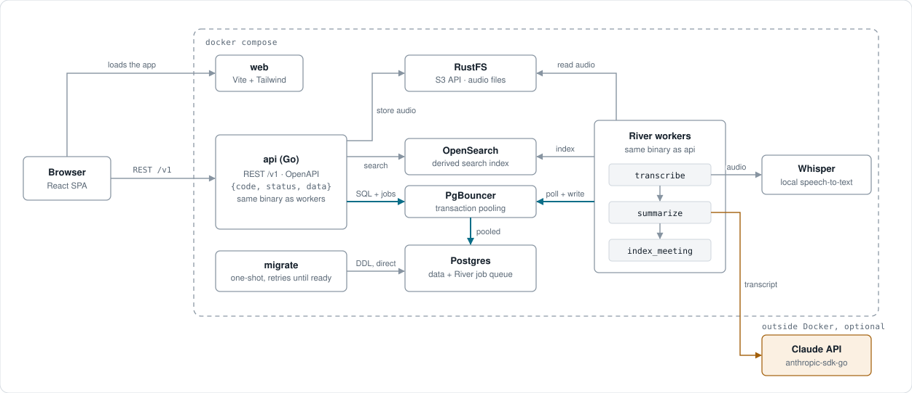
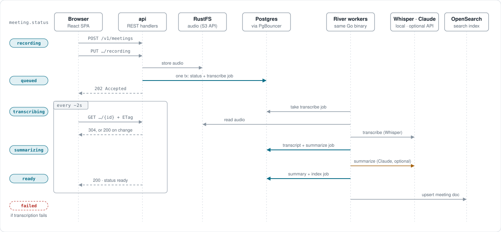

# Meeting Assistant

A meeting assistant built as a study project: record a meeting in the browser or upload an audio file, get a transcript, a summary with action items, and search across meetings.

- **Backend:** Go, one binary serving a REST API (OpenAPI contract) and running background jobs
- **Frontend:** React + TypeScript + Tailwind
- **Data:** Postgres (behind PgBouncer), River job queue, OpenSearch for search, S3-compatible object storage for audio
- **Transcription:** local Whisper (faster-whisper) in Docker, so your voice is transcribed on your machine with no API key

## Quick start

Requirements: Docker with Compose, and about 4 CPUs and 6 GB of RAM for Docker (OpenSearch and Whisper are the heaviest services). On macOS with Colima: `colima start --cpu 4 --memory 6`. On Linux hosts OpenSearch also needs `sudo sysctl -w vm.max_map_count=262144`.

```bash
cp .env.example .env   # local defaults work as is
make up                # builds and starts everything
make smoke             # end-to-end checks against the running stack (macOS: speaks a test sentence with `say`); deletes its test meeting at the end
```

The first transcription downloads the Whisper model (~500 MB, cached in a volume). `WHISPER_MODEL` in `.env` picks the size: `base` is faster, `medium` more accurate.

| URL | What |
|---|---|
| http://localhost:5173 | Meeting assistant web app |
| http://localhost:8081 | Swagger UI for the API |
| http://localhost:8080 | REST API (`/v1/...`, `/openapi.yaml`, `/readyz`) |
| http://localhost:9001 | Object storage console (RustFS) |
| http://localhost:9200 | OpenSearch |

Ports are published on `127.0.0.1` only, so other machines on your network can't reach the stack. `make debug` adds OpenSearch Dashboards on http://localhost:5601. `make down` stops the stack; `make reset` also deletes its data.

### Using it

- **Record:** open the web app → New recording → allow the microphone → talk → Stop → Save and process. Whisper transcribes your words. You can also upload an audio file in any common format.
- **Watch it process:** the meeting moves through `queued → transcribing → summarizing → ready`, and the page updates by itself.
- **Use the results:** click a transcript line to play from that moment, read the summary, tick off action items, regenerate the summary (ticks on unchanged items are kept), or delete the meeting with its recording.
- **When something goes wrong:** a failed transcription shows a short reason and a "Try again" button that reprocesses the stored recording. A failed summary keeps the meeting `ready` and searchable, keeps any earlier summary and shows the reason with "Try again". A recording with no speech ends `ready` with a warning.
- **Search:** search titles, participants, summaries, action items and transcripts; transcript matches link to the exact moment.
- **Claude summaries:** set `SUMMARY_PROVIDER=claude` and `ANTHROPIC_API_KEY` in `.env`, then `docker-compose up -d api` (or `docker compose`). Without a key the rule-based summarizer is used (the API logs a warning). Unknown provider or effort values stop the app at startup with a message naming the allowed values.

## Architecture

The system is a React app in front of a single Go binary that serves the REST API and runs the processing jobs. Postgres is the source of truth and also holds the job queue; audio lives in object storage; OpenSearch keeps a copy built for search. Speech-to-text and summaries are pluggable providers.



### Components

| Component | Role |
|---|---|
| `web` | React SPA: record with the microphone or upload a file, list and search meetings, and a meeting page with player, transcript, summary and action items. It talks only to the REST API. |
| `api` | One Go binary with three commands: `serve` runs the HTTP API and the River workers, `migrate` applies the schema and creates the search index and storage bucket, `reindex` rebuilds search from Postgres. |
| Postgres + PgBouncer | Meetings, transcripts, summaries, action items, and River's job tables. The app and workers go through PgBouncer; migrations connect directly. |
| Object storage (RustFS) | Audio files, through the S3 API. Keys are scoped by workspace and meeting. |
| OpenSearch | Search index derived from Postgres; it can be rebuilt at any time. |
| Whisper | Local speech-to-text over HTTP (faster-whisper). |
| Claude API | Optional summarizer. Without a key a rule-based summarizer runs offline. |

### Backend layers


Dependencies point inward: HTTP code calls use cases, use cases call the database, the queue and adapters, and `cmd/app` wires everything from config.

| Layer | Package | Responsibility |
|---|---|---|
| Contract | `api/gen` | Routes, parameter parsing and types generated from `api/openapi.yaml` |
| HTTP | `api` | Handlers that map HTTP to use cases; the response envelope; error → status mapping; logging, CORS and ETag middleware |
| Use cases | `internal/meeting` | Validation, status rules, transactions, and enqueueing the job that starts processing |
| Pipeline | `internal/jobs` | One River worker per step, with timeouts, retries and failure handling |
| Domain | `internal/domain` | Statuses and their rules, domain errors; no infrastructure imports |
| Persistence | `internal/store` | goose migrations and type-safe queries generated by sqlc |
| Adapters | `internal/{storage,transcription,summary,search}` | Each behind a small interface, so providers swap by config (`TRANSCRIPTION_PROVIDER`, `SUMMARY_PROVIDER`) and tests use fakes |

### Processing pipeline



```
recording ──upload──► queued ──► transcribing ──► summarizing ──► ready
                         │            │                 │            ▲
                         └─► failed ◄─┘                 └────────────┘
                          (retry → queued)        summary failed: stays ready
                                                  with summary_error
```

- **Transactional handoff:** an upload is stored first. Then one transaction sets the meeting to `queued` and enqueues `transcribe`. Each step saves its result, moves the status forward and enqueues the next job in the same transaction, so a crash never leaves a meeting between steps. The queue lives in Postgres, so there is no dual write to a separate broker.
- **Safe retries:** a job loads the meeting and does nothing if the status has moved on, so a stale or repeated job is harmless. Jobs retry with backoff; rate limits wait for `Retry-After`. After the last attempt, or on an error retrying can't fix (bad audio, a 4xx from a provider), a transcription failure makes the meeting `failed`, while a summary failure keeps it `ready` with `summary_error` and still indexes the transcript. People see a short reason; the full provider error goes to the logs.
- **Indexing doesn't block:** `index_meeting` runs after `ready`. If it fails, search is delayed but the meeting stays usable.
- **Re-runs:** a meeting that is `ready` or `failed` accepts a new upload (back to `queued`). A `ready` meeting can regenerate its summary (back to `summarizing`); a `failed` one is retried from its stored recording. Each upload is stored under its own key, so a replaced recording is never overwritten while a job reads it; once the new upload is committed, the old file and the old search entry are removed.
- **Deletes:** deleting a meeting removes its rows, every recording stored under the meeting and its search entry. A job still running for it stops when it finds the meeting gone, and indexing re-checks the meeting so a delete can't leave a search entry behind.
- **Queues:** each step has its own queue and worker count (`RIVER_*_WORKERS`), so slow transcriptions don't hold up summaries.

### Data model


Every table carries `workspace_id`, so accounts and sharding can come later. IDs are UUIDv7 (time-ordered), which keeps inserts index-friendly and lets lists paginate by ID.

- `workspaces`: one seeded workspace for now (no sign-in)
- `meetings`: title, participants, status, error (why processing failed), summary_error (why the last summary failed), audio location, duration, and an optional idempotency key (unique per workspace)
- `transcripts`: one row per meeting with its segments (speaker, start/end ms, text) as JSONB, written once and read whole
- `summaries`: overview, takeaways, decisions and questions, plus the provider, model and token usage
- `action_items`: text, owner, due date and done flag, ordered by position

### API

`api/openapi.yaml` is the contract: Go routing and types come from oapi-codegen, and TypeScript types from openapi-typescript (`make gen`). Every JSON response is `{"code", "status", "data"}`, or `{"code", "status", "error"}` on failure, where `code` repeats the HTTP status.

| Method | Path | Purpose |
|---|---|---|
| `POST` | `/v1/meetings` | Create a meeting (`Idempotency-Key` makes retries safe) |
| `GET` | `/v1/meetings` | List meetings, newest first, cursor pagination |
| `GET` | `/v1/meetings/{id}` | Meeting with status, summary and action items (ETag → `304` when unchanged) |
| `DELETE` | `/v1/meetings/{id}` | Delete the meeting with its recording, results and search entry (`204`) |
| `POST` | `/v1/meetings/{id}/retry` | Process a `failed` meeting again from its stored recording (`202`) |
| `PUT` | `/v1/meetings/{id}/recording` | Upload or replace the audio and start processing (`202`) |
| `GET` | `/v1/meetings/{id}/recording` | Stream the audio, with `Range` support for seeking |
| `GET` | `/v1/meetings/{id}/transcript` | Transcript segments |
| `POST` | `/v1/meetings/{id}/summary/regenerate` | Summarize a `ready` meeting again from its transcript (`202`; `409` while processing or when no speech was recognized) |
| `PATCH` | `/v1/action-items/{id}` | Mark an action item done or not done |
| `GET` | `/v1/search` | Search titles, participants, summaries, action items and transcripts |
| `GET` | `/healthz`, `/readyz` | Liveness, and readiness of Postgres, OpenSearch and storage |

### Frontend

- **Pages:**
  - `MeetingsPage`: meetings grouped by day with status filters and search, cursor pages with Load more, and a highlights panel for the latest processed meeting
  - `RecordPage`: record with `MediaRecorder` or pick a file, create the meeting, then upload the audio
  - `MeetingPage`: audio player synced with the transcript, with the summary and action items in the side panel
- **Server state:** TanStack Query owns fetching, caching and polling. Pages poll only while a meeting is processing (the interval comes from its status), and ETags make unchanged polls cheap.
- **Typed client:** `src/api/client.ts` wraps openapi-fetch, typed by the generated `schema.d.ts`, and unwraps the envelope into data or an `ApiError`. Contract changes surface as type errors.
- **Routing:** a small router on the History API (`src/router.tsx`) instead of a routing library; the app has three routes.
- **UI and logic:** shared components in `src/components`, shared query hooks in `src/hooks.ts` (the sidebar and the meetings page read the same cached list), and pure helpers in `src/lib` (status rules, formatting, day grouping and filters) unit-tested with `it.each` / `describe.each`.
- **Look:** a dark app shell (`components/layout.tsx`): an icon rail, a sidebar with search, status filters and recent meetings, a top bar with the Record action, and a right-hand panel (highlights on the list, summary and action items on a meeting) that moves below the content on narrow screens. Colors are Tailwind theme tokens in `styles.css`, plus two small utilities: `text-gradient` for accent words and stats, and `ambient`, a violet glow over a faint dot grid. The Meetings page opens with a welcome block holding the pill-shaped search, feature tags and stats. Type is Inter, with Rubik for display headings, and there's a small inline icon set (`components/icons.tsx`). The top bar's status chip polls `/readyz`.
- **Same origin:** in development Vite proxies `/v1`, `/readyz` and `/openapi.yaml` to the API, so the browser needs no CORS.

### Search

OpenSearch holds one document per meeting, with transcript lines as nested documents, so a match can point to the exact moment in the recording. Results come back as plain and highlighted text parts, so the client never renders HTML. Postgres stays the source of truth: `docker-compose run --rm api reindex` rebuilds the index. The index is versioned behind the `meetings` alias (`meetings-v2` now): when the mapping changes, `migrate` creates the next version, copies the documents with `_reindex` and swaps the alias in one step, so search never sees an empty index.

### Infrastructure notes

- **PgBouncer in transaction mode:** River runs poll-only because LISTEN/NOTIFY doesn't pass through transaction pooling. PgBouncer 1.21+ keeps pgx's prepared statements working.
- **Local first:** everything runs in Docker Compose, and the defaults need no API key (local Whisper, rule-based summaries).

### Code layout

```
api/openapi.yaml          REST contract (source of truth)
backend/
  cmd/app/                entry point and wiring: serve | migrate | reindex
  api/                    handlers, middleware, response envelope; gen/ is generated
  internal/meeting/       use cases
  internal/jobs/          River pipeline steps
  internal/domain/        statuses, rules, errors
  internal/store/         migrations, SQL queries, generated db/ package
  internal/storage/       S3 audio storage
  internal/transcription/ Whisper and fake providers
  internal/summary/       Claude and rule-based summarizers
  internal/search/        OpenSearch index and queries
web/src/
  pages/                  Meetings, Record, Meeting, Highlights panel
  api/                    typed client + generated schema
  components/             app shell (layout.tsx), shared UI, icons
  lib/                    pure helpers: status, formatting, meeting grouping
  hooks.ts                shared TanStack Query hooks
  router.tsx, main.tsx    routing and entry point
docs/architecture/        diagrams used in this README
deploy/pgbouncer/         PgBouncer image
scripts/smoke.sh          end-to-end checks
```

## Development

```bash
make test            # Go backend tests + web tests in the container
make test-integration  # pipeline and service tests against the stack's Postgres, each in a throwaway database
make gen             # regenerate Go server/types, sqlc queries and TypeScript types from the contract
make logs            # follow all service logs
```

Go 1.27 runs the backend tests on the host. The web tests run in the container because Tailwind 4 needs Node 20+. Tests are table-driven in Go and use `it.each` / `describe.each` in TypeScript.

## Third-party tools

| Area | Tool | Used for |
|---|---|---|
| Go | pgx, sqlc | Postgres driver, type-safe queries generated from SQL |
| Go | River | Postgres-backed job queue |
| Go | goose | SQL migrations |
| Go | oapi-codegen | HTTP routing and types from the OpenAPI contract |
| Go | aws-sdk-go-v2 | S3 client for audio storage |
| Go | anthropic-sdk-go | Claude summaries (optional) |
| Infra | Postgres 18, PgBouncer 1.25 | Database (UUIDv7 IDs), connection pooling |
| Infra | OpenSearch 3.8 | Full-text search with highlighted snippets |
| Infra | RustFS 1.0 | S3-compatible object storage (MinIO no longer publishes images on Docker Hub) |
| Infra | openai-whisper-asr-webservice (faster-whisper) | Local speech-to-text |
| Infra | Swagger UI | Browsing and trying the API |
| Web | React 19, Vite 6, Tailwind CSS 4 | UI, dev server and build, styling |
| Web | Inter (Google Fonts) | Typeface |
| Web | TanStack Query, openapi-fetch, openapi-typescript | Data fetching and polling, typed API client |
| Web | Vitest, Testing Library, jsdom | Tests |
| AI | Claude Code | Pair-programming the design and implementation |

## Assumptions

- **No sign-in:** everything belongs to one seeded workspace. Every table still has `workspace_id`, so accounts and sharding can be added later.
- **Transcription:** local Whisper (`small` model on CPU). It has no speaker separation, so lines are labeled "Speaker", or with the participant's name when a meeting has exactly one; a 30-minute meeting takes a few minutes.
- **Default summarizer:** a rule-based summarizer is the default so the stack runs offline. Claude is used when a key is configured.
- **OpenAPI 3.0.3:** used instead of 3.1 because oapi-codegen doesn't fully support 3.1 yet.
- **Uploads go through the API** (200 MB limit by default); presigned direct uploads are listed below as a scale point.

## Claude API cost estimate

The SDK is free; the cost is Claude API usage, and only the summarize step calls it. With the default rule-based summarizer the cost is $0. Prices are per 1M tokens as of November 2026; check Anthropic's pricing page before relying on them.

| Model | Input | Output |
|---|---|---|
| Claude Opus 5.5 | $4.00 | $20.00 |
| Claude Sonnet 5.5 | $2.00 | $10.00 |
| Claude Haiku 5.5 (default) | $0.10 | $0.50 |

A 30-minute meeting is about 4,500 spoken words. With speaker names, timestamps and the prompt, that's ~11k input tokens; the summary JSON plus low-effort thinking is ~2.5k output tokens. These are estimates; the app stores real token usage on each summary (`summaries.input_tokens`, `output_tokens`).

| Model | Per meeting | Per user per month (5 meetings/week) | 1M users per month | With Batch API |
|---|---|---|---|---|
| Opus 5.5 | ~$0.094 | ~$2.04 | ~$2.0M | ~$1.0M |
| Sonnet 5.5 | ~$0.047 | ~$1.02 | ~$1.0M | ~$0.51M |
| Haiku 5.5 | ~$0.0024 | ~$0.05 | ~$51k | ~$25k |

About 100 real test meetings cost ~$0.24 on Haiku 5.5 (~$9 on Opus 5.5). Haiku has no server-side fallback, so a refused summary leaves the meeting `ready` with a warning and "Try again". Speech-to-text and infrastructure are not included. Ways to lower it: low effort and capped `max_tokens` (already set), a compact transcript format in the prompt, prompt caching for follow-up questions about a meeting, and the Batch API for work that can wait.

## Pending Scale Points (TODO)

What the app deliberately does **not** do yet. This first version keeps the simplest design; each item is a known next step, not a missing piece. Items are grouped by the pressure that triggers them, and each names the signal to watch and what exists today.

### Sizing assumptions

These are assumptions, not measurements. Every figure scales linearly with them:

- meetings per day = users × meetings per user per week ÷ 7
- transcript bytes per day = meetings per day × ~50 KB (30-minute meeting)
- audio bytes per day = meetings per day × meeting length × 64 kbps

With 1M active users and 5 meetings of 30 minutes per user per week:

| Metric | Estimate |
|---|---|
| Meetings | ~700k/day (~8/s average; assume ~10x at business-hour peaks) |
| Transcripts | ~50 KB JSON per meeting → ~35 GB/day |
| Audio | ~15 MB per meeting at 64 kbps → ~10 TB/day |

Data volume, not request rate, is the main constraint.

### Before production

Needed whatever the load.

- [ ] **Metrics and traces with OpenTelemetry**, plus alerts on queue depth, job latency and failure rate. _Now: structured logs only._
- [ ] **Multi-node OpenSearch cluster with replicas**, for availability. _Now: a single node._

### Data growth

The main constraint: ~35 GB of transcripts and ~10 TB of audio a day.

- [ ] **Transcripts as compressed files in object storage**, with a pointer in Postgres — when transcripts drive database growth. _Now: JSONB in Postgres._
- [ ] **Time-based partitioning** of `meetings` and `river_job` — when tables reach hundreds of millions of rows and vacuum slows down. _Now: plain tables._
- [ ] **Audio lifecycle rules** to cold storage, with retention per workspace — when storage cost grows. _Now: all audio in standard storage._
- [ ] **Separate segments index** with `collapse` on `meeting_id` — when nested documents inflate indexing cost and index size. _Now: segments nested in the meeting document._
- [ ] **Time-based search indices** with Index State Management (hot/warm/cold) — when old meetings drive search size and cost. _Now: one index behind the `meetings` alias._
- [ ] **Shard Postgres by `workspace_id`** (Citus or app-level) — when vertical scaling and replicas are exhausted. _Now: a single node._

### Background processing

Jobs, transcription and summaries.

- [ ] **Direct Postgres connection for River's listener** (LISTEN/NOTIFY) — when the delay between enqueue and pickup is noticeable. _Now: poll-only, since LISTEN/NOTIFY doesn't pass through PgBouncer transaction pooling._
- [ ] **Separate `cmd/api` and `cmd/worker`**, scaled independently — when the job backlog grows or processing needs different scaling than the API. _Now: one binary._
- [ ] **Dedicated Postgres for River, or SNS/SQS or Kafka** — when job writes compete with app queries. _Now: jobs live in the main Postgres._
- [ ] **Chunked, parallel transcription** — when long meetings exceed the latency target or provider limits. _Now: one call per recording._
- [ ] **GPU workers or hosted speech-to-text** — when long meetings wait too long. _Now: Whisper on CPU._
- [ ] **LLM cost levers**: prompt caching, Message Batches API for non-urgent work — when LLM spend per meeting becomes material. _Now: one Haiku 5.5 call per summary, ~$0.0024._

### Request load

API traffic, database connections and search queries.

- [ ] **Presigned uploads** to S3/GCS, straight from the browser — when proxying uploads costs API bandwidth and CPU. _Now: RustFS, with uploads going through the API._
- [ ] **Several PgBouncer processes** (`so_reuseport`) or a managed pooler — when PgBouncer CPU saturates. _Now: one process, which uses one core._
- [ ] **Read replicas** for lists, dashboards and meeting pages — when reads dominate primary CPU. _Now: a single primary._
- [ ] **SSE push of status changes** — when polling traffic from open tabs becomes significant. _Now: the client polls every ~2s and gets `304` while nothing changed._
- [ ] **Redis** for hot reads and per-workspace rate limits — when hot reads repeat, and to protect STT and LLM spend. _Now: no cache or rate limiting._
- [ ] **Route search by `workspace_id`** — when every query fans out to all shards and latency rises. _Now: default routing._

### New clients and features

- [ ] **GraphQL layer** over the same services; REST stays for uploads and SSE — when several clients (mobile, integrations, public API) need different shapes of the same data, or one screen needs many chained REST calls. _Now: REST + OpenAPI, one client._
- [ ] **Speaker labels**, from a hosted speech-to-text or a diarization model — when people need to know who said what. _Now: none._
